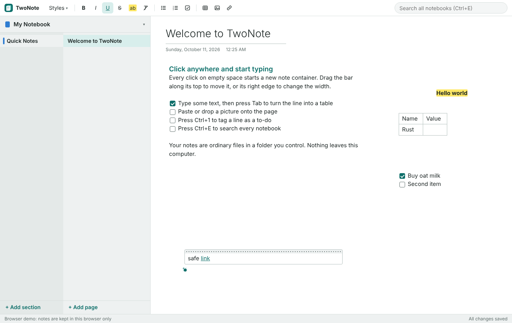

# TwoNote

A local-first, open source notebook app in the freeform style of OneNote:
notebooks, colour-coded sections, pages and subpages, and a canvas where you
click anywhere and start typing.

Built with a Rust core and a [Tauri](https://tauri.app) shell. Notes are plain
JSON files in a folder you own. The app makes no network requests.



## Status

Milestone 1: a usable notebook app with its own open format.

What works today:

- Notebooks, sections (colours, rename, drag to reorder) and pages (subpages
  to two levels, drag to reorder, drop onto a section to move)
- Freeform canvas: click empty space for a new note container, drag it by its
  top bar, resize it from its right edge
- Rich text: headings, bold, italic, underline, strikethrough, highlight,
  bullet and numbered lists, links, to-do tags with tick boxes
- Tables: press Tab after some text to start one, Tab through cells, Tab in
  the last cell for a new row, right-click for row and column operations
- Pictures: paste, drop, or pick a file; drag to move, corner handle to resize
- Search across every notebook (Ctrl+E)
- Autosave, light and dark themes
- Deleting is safe: pages, sections and notebooks move to `.trash` inside the
  library instead of being destroyed

Not yet built (see [Roadmap](#roadmap)): importing `.one` files, ink, undo for
moving containers, page history, sync.

## Where your notes live

`Documents/TwoNote` by default. The path is shown in the status bar; click it
to open the folder. Set `TWONOTE_LIBRARY=/some/path` to keep the library
somewhere else, such as a folder synced by Syncthing or an encrypted volume.

The layout is documented in [docs/FORMAT.md](docs/FORMAT.md). It is designed
to be readable without TwoNote.

## Running it

Requirements: Rust (stable), Node 20+, and the
[Tauri system dependencies](https://tauri.app/start/prerequisites/) for your
platform.

```sh
npm install
npm run tauri dev      # run the desktop app with live reload
npm run tauri build    # produce an installable bundle
```

To try the interface in a browser with no install beyond Node, run
`npm run dev` and open http://localhost:1420. In that mode notes are kept in
the browser's local storage only.

## Shortcuts

Shortcuts follow OneNote's where one exists.

| Action | Shortcut |
| --- | --- |
| Search all notebooks | Ctrl+E |
| New page / new section | Ctrl+N / Ctrl+T |
| Previous / next page | Ctrl+PageUp / Ctrl+PageDown |
| Make subpage / promote | Ctrl+Alt+] / Ctrl+Alt+[ |
| Bold, italic, underline | Ctrl+B, Ctrl+I, Ctrl+U |
| Strikethrough | Ctrl+- |
| Highlight | Ctrl+Alt+H |
| Bullet list / numbered list | Ctrl+. / Ctrl+/ |
| To-do tag | Ctrl+1 |
| Heading 1, 2, 3 / normal text | Ctrl+Alt+1, 2, 3 / Ctrl+Shift+N |
| Insert link | Ctrl+K |
| Start a table, next cell | Tab |
| Open a link | Ctrl+click |

On macOS use Cmd in place of Ctrl.

## Layout of this repository

| Path | What it is |
| --- | --- |
| `crates/twonote-core` | Model, on-disk format, HTML sanitising, search. No UI, no network. |
| `src-tauri` | The desktop shell: a window and a thin command layer over the core. |
| `ui` | The interface, in plain TypeScript with no framework. |
| `tests/ui.mjs` | End-to-end test of the interface in headless Chromium. |
| `docs/FORMAT.md` | The notebook file format. |

## Tests

```sh
cargo test -p twonote-core            # storage, sanitising, search
npm run build && npm run test:ui      # interface, in headless Chromium
```

## Security model

- The web view talks to Rust only through TwoNote's own commands. Those take
  ids, never file paths, and the core rejects any id that is not a plain
  identifier, so the interface cannot read or write outside the library.
- Note content is a fixed subset of HTML. It is sanitised in Rust (with
  [ammonia](https://crates.io/crates/ammonia)) when written and again when
  read, so a notebook copied in from elsewhere cannot carry script.
- A strict Content Security Policy blocks inline script and all remote
  content. Pasted web content has its images removed rather than fetched.
- Links open in your default browser, and only `http`, `https` and `mailto`
  links are kept.

## Roadmap

1. Read-only import of OneNote `.one` section files, using Microsoft's
   published [MS-ONE] and [MS-ONESTORE] specifications
2. Undo and redo for canvas operations; page version history
3. Ink and drawing
4. Export to Markdown and HTML
5. Optional end-to-end encrypted sync

## How this was built

TwoNote is an independent, from-scratch implementation. It contains no
Microsoft code and was not derived from OneNote's binaries. Familiar
behaviour was reproduced from how the application visibly works. TwoNote is
not affiliated with or endorsed by Microsoft; OneNote is a trademark of
Microsoft Corporation.

## Licence

Apache-2.0. See [LICENSE](LICENSE).

[MS-ONE]: https://learn.microsoft.com/openspecs/office_file_formats/ms-one/
[MS-ONESTORE]: https://learn.microsoft.com/openspecs/office_file_formats/ms-onestore/
